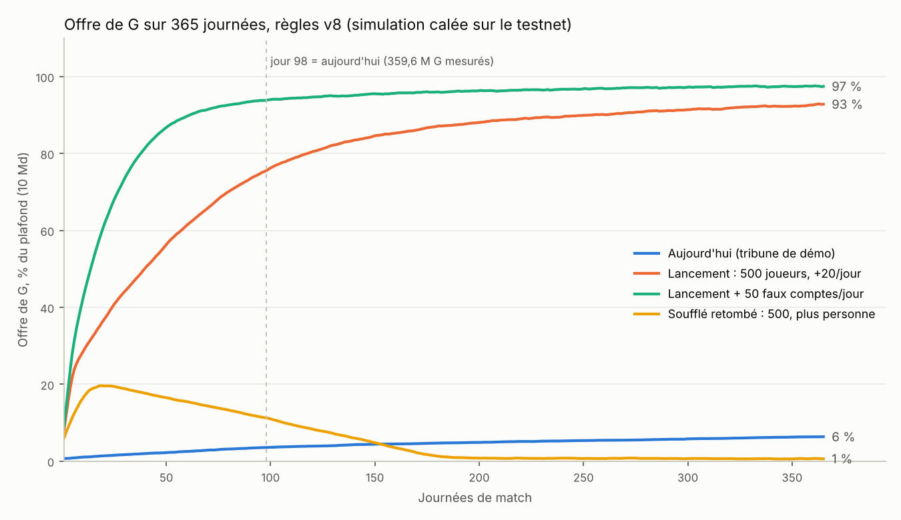
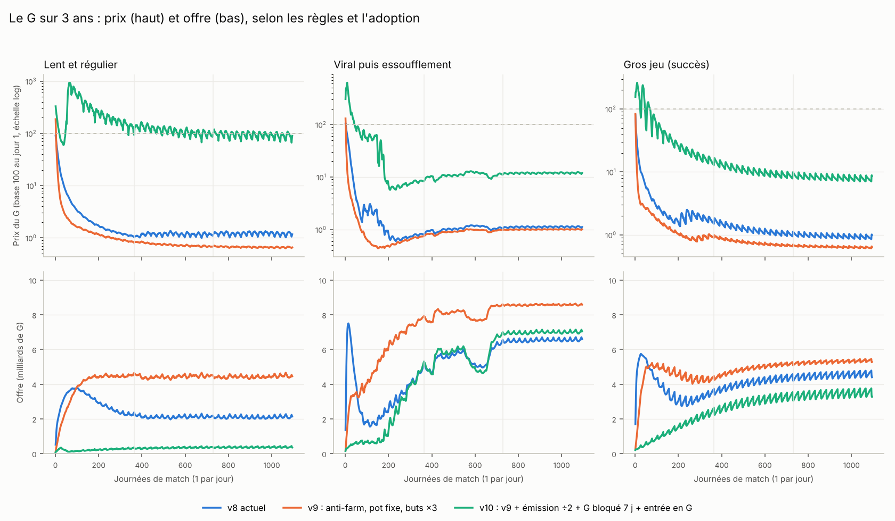
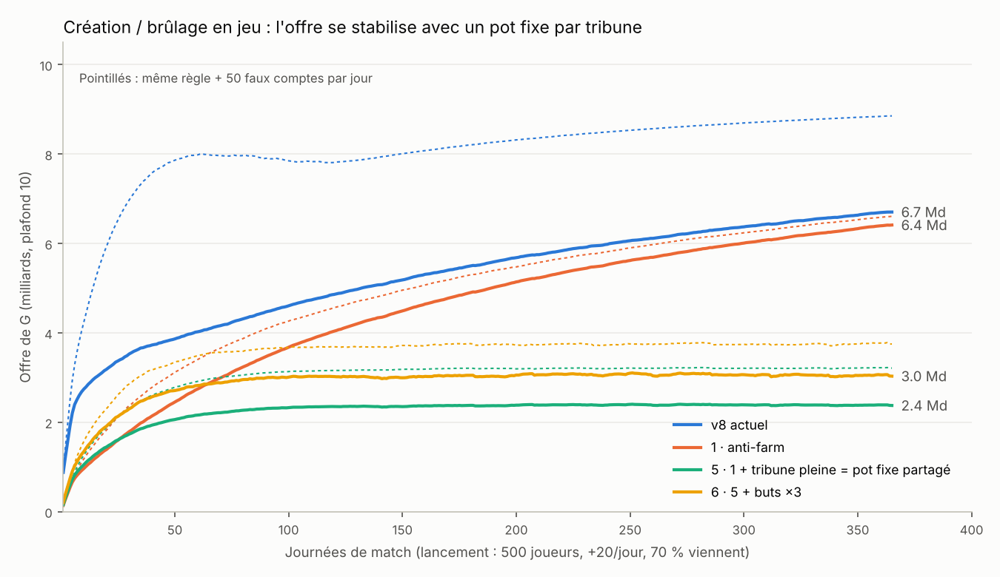

# G in v9: a memecoin that lives with the game

Design note, November 2026. Not deployed: the v8 contracts have no admin and no
upgrade method, and their rules are fixed in code (`the_rules()` in
`contracts/league/src/lib.rs`), so these changes mean new `*-v9` contracts and a
fresh league. Planned after the hackathon.

## What v8 does today

Measured on testnet with `node scripts/verify.mjs` (match day 98): 359.6M G of the
10B cap; G is minted only on the days the demo crowd fills its stands (≈ +9.4M G
net), and burned otherwise (≈ −0.43M G).

Simulated at launch scale (500 players, +20 a day, 70% come, rules from
`GET /v1/rules`), the G created comes from:

| Source | Share |
|---|---|
| Full houses (100k G per fan present) | 65% |
| Sign-up grant and welcome bonuses | 29% |
| Goals | 5% |

Three problems follow:

1. **Farming.** A new account earns 5M G (1M at sign-up, 1M at each of its first
   4 check-ins). 50 farmed accounts a day add 72% to the supply after 98 days.
2. **Presence counted by head.** The more accounts check in, the more G is
   created, with no limit but the cap. The football part (goals) barely counts.
3. **Selling.** Over three years, as soon as players sell even 10–30% of what they
   earn, G loses 98–99% of its price in the first year, in every adoption scenario.
   The supply is not the issue (the game burns 97–100% of what it creates); the
   net selling is.



## v9, in short

| | v8 | v9 |
|---|---|---|
| Sign-up | 5M G per account | 0 G that can be sold; a starter kit (1 training, 1 pack) that cannot; a small bonus only after a real match |
| Who fills a stand | any account that checks in | fans with a stake in the club (season ticket or footballer) |
| A full house | 100k G per fan present | a fixed pot shared by those present, growing with the club's full-house streak |
| Goals | 600k G | worth more than presence: scoring and winning pay |
| What you earn | sellable at once | claimable, sellable after 7 days; unclaimed after 30 days, burned |
| Uses of G | training, packs, transfers | the same, plus painting the tifo, daily nutrition, half of each season ticket burned |
| How much is created | scaled by the room left under the cap | set so an active player earns a little less than he wants to spend |

## What the simulations say

Three years, one match day a day, every v8 flow (onboarding, goals with late and
derby multipliers, full houses, season tickets, salaries, training, packs, sale
tax, own goals, empty stands, relegation, the cap), three adoption curves, a
farming attack, and a G/USDC pool where players sell part of what they earn and
newcomers buy.



| Price after 3 years, vs day 1 | v8 | v9 |
|---|---|---|
| Slow and steady | −88 to −99% | −10% to +25% |
| Viral then fading | −99% | −88% |
| Big success | −97 to −99% | −82 to −91% |
| Effect of 50 farmed accounts a day on supply | +72% | ~0 |

What holds whatever the assumptions:

- **Price ≈ dollars coming in per day / G sold per day.** Burns help only when they
  make players buy G with money (they want to spend more than they earn) or keep
  their G instead of selling it. Burning G that was earned in play brings in no
  dollar: adding the tifo, nutrition and a 50% season-ticket burn on top of v9
  moved the 3-year price by ×0.88 to ×1.08 in the model.
- **About 70% of all G ends up asleep** with players who left. A slow burn of
  sleeping wallets would cut the supply 16–23% but barely move the price (that G is
  not sold anyway), and it cannot be done on NEP-141 balances without a decaying
  token, which would tax every holder: not in v9.
- **Success dilutes** if demand is one-off: creation grows with the number of clubs
  while newcomers buy only once. v9 needs recurring purchases by every active
  player (season pass, cosmetics) to hold its price at scale.
- Fixed shared pots per full stand stop the supply from climbing toward the cap.



## Limits of the model

What people do is assumed, not measured: the share of earnings sold (10–30%),
what newcomers buy ($5–20), how much players want to spend, attendance, and the
pool's launch liquidity ($20k against 200M G). The only calibration is the live
supply at match day 98. Read the differences between rules and scenarios, not the
absolute prices.

## Reproduce

```
cd docs/economy/sim
python3 final.py      # 3 adoption curves x v8/v9/v10, plus a farming attack -> final.json
python3 zero.py       # zero G at sign-up, and a slow burn of sleeping wallets
python3 burns.py      # tifo, nutrition, season-ticket burn
python3 econ_game.py out.json   # one-year in-game rule variants
```

Python 3 with numpy. `g3y.py` is the model; `g3y2.py` adds sleeping wallets,
`g3y3.py` adds the new burns.
